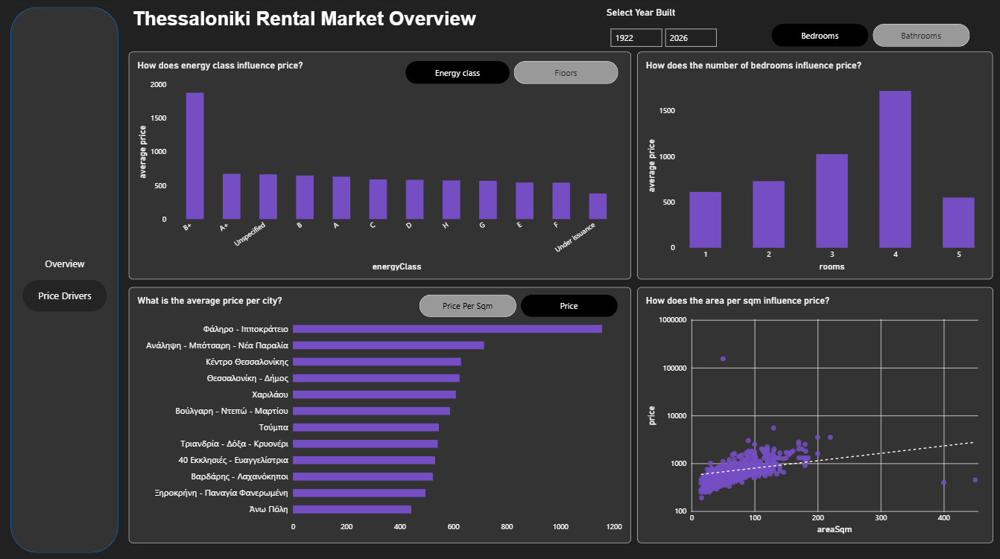

# Thessaloniki Apartment Rent Price Prediction

## Problem Statement

Rent prices in Thessaloniki vary significantly depending on a wide range of property attributes like size, floor, age, amenities, neighbourhood, and more. This project builds a regression model that takes a set of apartment features and predicts the expected monthly rent price in euros. The goal is twofold:

1. **For tenants and buyers**: get an instant, data-driven estimate of whether a listing is fairly priced.
2. **For landlords and agents**: understand which property attributes drive rent prices the most, informing renovation and investment decisions.

To make the data and model insights accessible to non-technical stakeholders, an interactive Power BI dashboard was developed. The dashboard visualizes geographical rent distributions, property attribute impacts, and market trends across Thessaloniki's neighbourhoods.



The target variable is `price` (monthly rent in euros).

---

## Data Collection

### Source

All data was collected from [www.spitogatos.gr](https://www.spitogatos.gr/), the largest real estate listing platform in Greece. The website aggregates residential and commercial property listings from across the country, with detailed structured fields for each property.

**Attribute parsing** — For each individual listing, the following structured fields were extracted and mapped to column names:

   | Scraped Field | Column Name | Type | Description |
   |---|---|---|---|
   | Price | `price` | Numeric | Monthly rent in euros |
   | Area (square metres) | `areaSqm` | Numeric | Usable floor area of the apartment |
   | Price per sqm | `pricePerSqm` | Numeric | Derived price metric |
   | Rooms | `rooms` | Numeric | Total number of rooms |
   | Bathrooms | `bathrooms` | Numeric | Number of bathrooms |
   | Kitchens | `kitchens` | Numeric | Number of kitchens |
   | Living rooms | `livingRooms` | Numeric | Number of living rooms |
   | Floor | `floor` | Numeric | Floor number |
   | Year built | `yearBuilt` | Numeric | Construction year of the building |
   | Renovation year | `renovationYear` | Numeric | Year of last renovation |
   | Closed parking spots | `closedParkingSpots` | Numeric | Number of garage/ closed spots |
   | Open parking spots | `openParkingSpots` | Numeric | Number of open parking spots |
   | Energy class | `energyClass` | Categorical (A+–H) | Energy performance certificate rating |
   | Location | `location` | Text | Full location string (e.g., "Thessaloniki - Center") |
   | Air conditioning | `airConditioning` | Binary | Whether the apartment has A/C |
   | Alarm | `alarm` | Binary | Whether a security alarm is installed |
   | Balcony | `balcony` | Binary | Whether the apartment has a balcony |
   | Elevator | `elevator` | Binary | Whether the building has an elevator |
   | Fireplace | `fireplace` | Binary | Whether the apartment has a fireplace |
   | Furnished | `furnished` | Binary | Whether the apartment is furnished |
   | Garden | `garden` | Binary | Whether the apartment has a garden |
   | Has parking | `hasParking` | Binary | Whether any parking is available |
   | New development | `isNewDevelopment` | Binary | Whether the property is newly built |
   | Pets allowed | `petsAllowed` | Binary | Whether pets are permitted |
   | Pool | `pool` | Binary | Whether a pool is available |
   | Solar heater | `solarHeater` | Binary | Whether a solar water heater is installed |
   | Storage | `storage` | Binary | Whether a storage room is included |
   | View | `view` | Binary | Whether the apartment has a notable view |
   | Listing ID | `listingId` | Text | Unique Spitogatos listing identifier |
   | Listing type | `listingType` | Text | Rent/sale |
   | Property type | `propertyType` | Text | Apartment/house/etc. |

### Data Volume

The final dataset contains apartment rental listings from across Thessaloniki's neighbourhoods, spanning a range of prices, sizes, and building ages typical of the city's rental market.

---

## Pipeline Overview

The project follows a sequential ML pipeline, with each stage documented in its own Jupyter notebook:

```
Data Collection (Spitogatos scraping)
        │
        ▼
   spitogatos.csv
        │
        ▼
┌─────────────────┐
│  1. EDA          │  Explore distributions, missing values, correlations
└────────┬────────┘
         │
         ▼
┌─────────────────┐
│  2. Missing       │  Impute missing values per feature type
│     Values       │  (mode, median, indicator variables)
└────────┬────────┘
         │
         ▼
┌─────────────────┐
│  3. Outliers      │  Detect via IQR box plots, clip at 99th percentile
└────────┬────────┘
         │
         ▼
┌─────────────────┐
│  4. Transforms   │  Log-transform price and areaSqm, assess via Q-Q plots
└────────┬────────┘
         │
         ▼
┌─────────────────┐
│  5. Feature       │  Create aggregate, interaction, and extracted features
│     Engineering  │  (apartmentAge, rooms_area, floor_elevator, district, etc.)
└────────┬────────┘
         │
         ▼
┌─────────────────┐
│  6. Encoding     │  Label-encode 14 binary features,
│                  │  ordinal-encode energyClass (A+→H)
└────────┬────────┘
         │
         ▼
┌─────────────────┐
│  7. Train/Test   │  80/10/10 split
│     Split        │ 
└────────┬────────┘
         │
         ▼
┌─────────────────┐
│  8. Create        │  Define 4 feature subsets:
│     Subsets      │  original, all, uncorrelated, important
└────────┬────────┘
         │
         ▼
┌─────────────────┐
│  9. Model         │  Train RF & XGBoost on each subset via RandomizedSearchCV
│     Training      │  (8 models total)
└────────┬────────┘
         │
         ▼
┌─────────────────┐
│  10. Evaluation  │  Compare all 8 models on validation set,
│                  │  test best model on held-out test set
└─────────────────┘
```

---

## Project Structure

```
├── eda.ipynb                          # Exploratory data analysis
├── missing_values.ipynb               # Missing value treatment
├── outliers.ipynb                     # Outlier detection
├── transforms.ipynb                   # Distribution transformations
├── feature_eng.ipynb                  # Feature engineering
├── encode.ipynb                       # Encoding
├── train_test_split.ipynb             # 80/10/10 split
├── create_subsets.ipynb               # Define and export 4 feature subsets
├── train_subset1.ipynb                # Train RF & XGBoost on original features
├── train_subset2.ipynb                # Train RF & XGBoost on all features
├── train_subset3.ipynb                # Train RF & XGBoost on uncorrelated features
├── train_subset4.ipynb                # Train RF & XGBoost on important features
├── evaluation.ipynb                   # Model comparison & final test evaluation
```

## Model Results

### Validation Set Comparison

| Model | Subset | MSE | RMSE | MAE | R2 | Latency (ms) |
|---|---|---|---|---|---|---|
| Random Forest | Original | 0.044 | 0.209 | 0.153 | 0.725 | 44.2 |
| XGBoost | Original | 0.043 | 0.208 | 0.155 | 0.727 | 11.9 |
| Random Forest | All | 0.041 | 0.204 | 0.151 | 0.738 | 59.7 |
| XGBoost | All | 0.041 | 0.203 | 0.152 | 0.739 | 10 |
| Random Forest | Uncorrelated | 0.044 | 0.209 | 0.154 | 0.723 | 31.4 |
| **XGBoost** | **Uncorrelated** | **0.041** | **0.203** | **0.155** | **0.74** | **9.1** |
| Random Forest | Important | 0.045 | 0.212 | 0.157 | 0.715 | 53.1 |
| XGBoost | Important | 0.046 | 0.214 | 0.159 | 0.710 | 5.2 |

### Best Model: XGBoost (Uncorrelated Features)

The XGBoost model trained on the uncorrelated feature subset was selected as the final model and evaluated on the held-out test set:

| Metric | Validation | Test |
|---|---|---|
| MSE | 0.041 | 0.026 |
| RMSE | 0.203 | 0.163 |
| MAE | 0.155 | 0.129 |
| R2 | 0.74 | 0.741 |
| Latency (ms) | 9.1 | 8.1 |

## Future Work

- **Location encoding**: Replace the coarse `district` label with precise coordinates or geospatial embeddings to capture neighbourhood-level price variation more accurately.
- **Text features**: Extract information from listing descriptions (e.g., "recently renovated", "luxury", "near metro") using NLP techniques.
- **Temporal features**: Incorporate time-of-year and market trend data to capture seasonal demand fluctuations.